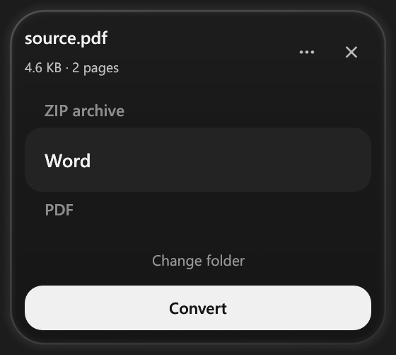

# Dropflip

  

**Convert files locally from a corner of your screen.**

Dropflip is a Windows desktop converter with a native Rust interface. Drag a file toward a drop area, choose a compatible output format, and confirm. It saves the result to Downloads or your chosen folder.

[Build from source](docs/DEVELOPMENT.md) · [Conversion behavior](CONVERSIONS.md) · [Tests](qa/README.md)

## Current status

This repository contains the source and build scripts. The Windows build has been tested locally; this source import does not include an installer or a bundled release download. Conversion engines are installed separately.

## How to use it

1. Start `Dropflip.exe`. It stays in the tray while idle.
2. Drag a file into a drop area. The initial area is at the bottom-left corner above the taskbar.
3. Scroll, drag, or click the format list. A format with compression support includes a quality slider, initially at 100%.
4. Choose **Convert**. Dropflip saves the output and dismisses the completed panel after 2.5 seconds.

  

The panel above was captured from the running native build. Long filenames scroll after a two-second pause.

**Change folder** opens the destination picker and remembers your choice. The tray menu opens Settings, where you can add drop areas, change their dimensions, or drag their placement guides. Areas remain available over windowed and maximized apps. They hide for a focused fullscreen app unless you enable **Show above fullscreen**.

The format picker also supports arrow keys, Home, and End. Ctrl+O chooses a file. Settings opened through the file menu returns to that file; opening Settings directly gives it a close button.

## Supported conversions

Available choices depend on the input and installed engines.

| Input | Common outputs |
| --- | --- |
| Images, HEIC/HEIF, AVIF and SVG | PNG, JPEG, WebP, AVIF, GIF, TIFF, BMP, ICO, TGA, QOI, PDF where supported |
| Video and animated GIF/WebP | MP4, MKV, MOV, WebM, AVI, GIF; audio extraction when audio exists |
| Audio | MP3, M4A, AAC, Opus, Ogg, FLAC, WAV, AIFF, WMA |
| PDF | DOCX, PPTX/PPT, detected tables as XLSX, text/OCR, PNG/JPEG/SVG pages, PDF compression |
| DOC/DOCX, ODT, RTF and supported text/ebook formats | Office formats, PDF, standalone HTML, text, EPUB, Markdown/LaTeX/RST resource bundles |
| XLS/XLSX/ODS and supported workbook variants | Workbook formats, PDF, CSV/TSV, typed JSON |
| JSON, YAML, TOML, CSV and TSV | Compatible structured formats, flat tables, XLSX, ODS, PDF |
| Any regular file | A ZIP archive containing the original |

Multi-page PDF/TIFF image exports include every page. Multi-sheet spreadsheet text exports include every sheet. These collections use ZIP files with separate page or sheet entries. Markdown, LaTeX and RST exports bundle referenced images with the document source.

Read [the conversion matrix](CONVERSIONS.md) for the exact preservation rules and limits.

## Strengths

- File conversion runs through local tools without an account, upload service, or subscription. Setup downloads the required components.
- The compact Rust UI stays out of the taskbar and appears around a configurable drop area.
- Originals remain unchanged. Outputs use temporary staging, receive unused filenames, and publish only after success.
- Supported container conversions keep additional audio/subtitle tracks; MKV also keeps attachments. Compatible media codecs can be copied without re-encoding.
- Native spreadsheet writers stream rows, animation intermediates process one frame at a time, and dropping a file does not generate a thumbnail or video preview.

## Weaknesses and current limits

- Windows x64 is the current target. Drop-area placement is limited to the primary display.
- Full format coverage needs several external engines, including a large LibreOffice installation. The executable alone is not the complete converter.
- PDF-to-Word reconstructs layout and can reflow complex pages. OCR currently includes English and Indonesian and can misread poor scans.
- PDF-to-PowerPoint keeps scanned/rotated text as artwork. It does not reconstruct charts or tables as editable PowerPoint objects. PDF-to-Excel extracts detected digital tables; scanned-table recognition is unsupported.
- Destination formats have their own limits. CSV/TSV omit formulas and formatting, GIF has a limited palette, and lossy image/audio/video formats introduce generation loss.
- The quality percentage is not an exact file-size reduction target. Some files cannot be made smaller without discarding information.
- Jobs run one at a time. Multiple dropped files require individual confirmation; folders and archive extraction are not supported.
- Exclusive fullscreen games have not been validated. The app has no auto-updater, and this repository currently provides a source build rather than an installer.
- Documents with externally linked assets may need those resources to remain available.

## Build and run

See [the development guide](docs/DEVELOPMENT.md) for toolchain requirements, engine installation, build commands, startup setup, and the CLI.

The UI/coordinator and native image/data/spreadsheet routes use Rust. FFmpeg handles media; Pandoc, Typst and LibreOffice handle document formats. The supervised Python helper supplies PDF layout/OCR, table extraction, slide reconstruction and selected image codecs.

## Validation

The development release passed **105 real-output conversion checks and 11 Rust tests** on Windows. Checks decode outputs and inspect page counts, sheet values, bit depth, resources, and media streams. The native widget probes also exercised format scrolling, quality changes and Settings navigation.

These results cover the test corpus, not every codec or document feature. [QA instructions](qa/README.md) describe how to reproduce the checks. A fresh fixture set can add setup conversions to the reported count.

## License and credits

Dropflip's project-authored source is [MIT licensed](LICENSE). The reflected icon frame adapts [Dictately](https://github.com/AlthafTM/dictately); its MIT notice is retained in [assets/DICTATELY-LICENSE.txt](assets/DICTATELY-LICENSE.txt).

Conversion engines and dependencies keep their own licenses, including GPL/AGPL/MPL components. The MIT source license does not relicense those components. See [THIRD_PARTY.md](THIRD_PARTY.md) before distributing a runtime bundle.
